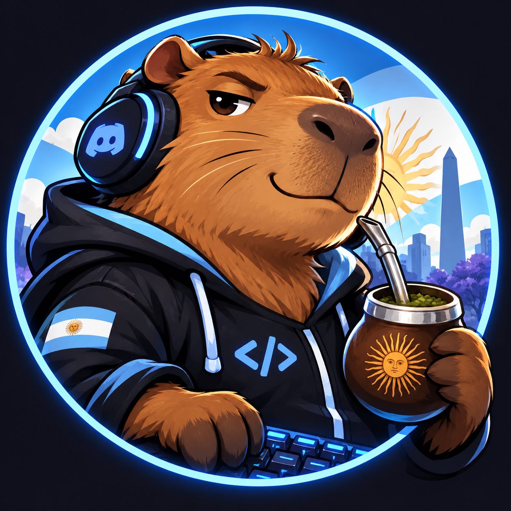

# Pepe, bot de Argentina Developer



Bot de Discord en TypeScript estricto con los comandos de ProBot, GIFs y comidas aleatorias. El ranking es opcional y viene deshabilitado. SQLite conserva XP y cooldowns por servidor para ejecutarlo en un LXC del homelab.

**Probar la propuesta:** `npm ci` y `npm run preview`; abrí [la sala local](http://127.0.0.1:4371). Usa tres miembros ficticios y una SQLite en memoria, sin token ni conexión a Discord. [Recorrido de la demo](docs/public-commands.md).

**Probar cumpleaños:** abrí [el laboratorio de regalos](http://127.0.0.1:4371/cumples). Permite iniciar `!cumple @persona`, confirmar participación, simular la exclusión manual de un admin, reiniciar y reincorporar. Usa el servicio real con SQLite en memoria y transporte simulado. [Configuración y comando temporal](docs/birthday-gifts.md#probar-en-el-laboratorio-web).

El padrón admite `categoria=gift` o `no-gift`. Pepe conserva los datos de `no-gift` y omite sus cumpleaños, sin aislar, convocar ni enviar privados; la demo los agrupa por separado.

## Comandos

Hay **13 comandos habilitados por defecto** y dos de participación opcionales. Todos son públicos, sin roles especiales. Aceptan texto natural o prefijo `!`, con o sin `?` y tildes: `café?`, `cafe` y `!cafe` ejecutan el mismo comando.

En las respuestas, `@usuario` representa a quien escribió el comando. Las probabilidades indicadas aplican con la feature correspondiente habilitada.

### Reacciones y ayuda

Estas respuestas son fijas: no tienen sorteo de premio o fracaso.

| Comando | Qué devuelve | Probabilidad |
| --- | --- | --- |
| `mate?` | Mención al autor + [GIF de DiCaprio brindando con mate](assets/probot/mate.gif). | 100 % |
| `vino?` | Mención al autor + [GIF de Inna tomando vino](assets/probot/vino.gif). | 100 % |
| `té?` | Mención al autor + [GIF original de té](assets/probot/te.gif). | 100 % |
| `café?` | Mención al autor + [imagen original de café (JPG)](assets/probot/cafe.jpg). | 100 % |
| `ban?` | Mención al autor + [GIF de Bane diciendo «no»](assets/probot/ban.gif). Sólo muestra el meme; no banea usuarios. | 100 % |
| `medialunas?` | Mención al autor + [GIF del croissant](assets/probot/medialunas.gif). | 100 % |
| `buen dia` | Mención al autor + [GIF de Francella: «Hermosa mañana, ¿verdad?»](assets/probot/buen-dia.gif). | 100 % |
| `pala?` | Mención al autor + [GIF de Homero asustado por la pala](assets/probot/pala.gif). | 100 % |
| `grupo comando?` | `¡Grupo comando presente, @usuario! ¿Cuál es la misión?` + [GIF original del grupo comando](assets/probot/ahj0Fx.gif). | 100 % |
| `ayuda` · aliases `comandos`, `help` | Lista de comandos habilitados y sus descripciones. | 100 % |

### Comidas: premio o fracaso

Cada pedido sortea **1/3 de premio (≈33,3 %) y 2/3 de fracaso (≈66,7 %)**. `almuerzo?` también acepta `aluerzo?` y `lamuerzo?`.

| Comando | Resultado | Texto de respuesta | Imagen o GIF | Probabilidad |
| --- | --- | --- | --- | --- |
| `desayuno?` | Premio | `Ligaste desayuno, @usuario. Kero dejó de comer dos segundos y te guardó algo. 🥐` | [Kero](assets/probot/animesher.com_sakura-card-captor-kero-1228813.gif) | 1/3 ≈ 33,3 % |
| `desayuno?` | Fracaso | `No puede ser, @usuario. Te volvieron a robar` | [Robo del desayuno](assets/probot/tumblr_934345c79e0a95d977e8ad2574a5527a_51bcac4f_400.gif) | 2/3 ≈ 66,7 % |
| `almuerzo?` | Premio | `@usuario es tu día de suerte! Sanji te guardó <3` | [Sanji](assets/probot/sanji-sanji-vin-smoke.gif) | 1/3 ≈ 33,3 % |
| `almuerzo?` | Fracaso | `Fuiste @usuario, te la robó Luffy 🙁` | [Luffy](assets/probot/tumblr_88ea4ba0d6546130a18d7077b2a0c2c6_02943bb8_540.gif) | 2/3 ≈ 66,7 % |
| `cena?` | Premio | `Hoy cenás como protagonista de anime, @usuario. El asado zafó de Luffy. 🥩` | [Asado (JPG)](assets/probot/contrafile-grill-com.jpg) | 1/3 ≈ 33,3 % |
| `cena?` | Fracaso | `Fuiste, @usuario. Sasha se comió tu cena antes de que terminara el opening. 🙁` | [Sasha](assets/probot/sasha-cena.gif) | 2/3 ≈ 66,7 % |

Cada intento es independiente y todos tienen las mismas chances: no se garantiza un premio cada tres pedidos. Primero se sortea el resultado y después su variante; agregar frases no cambia las probabilidades. No hay cupos ni cooldown de comida, y pedir comida no suma XP.

### Participación opcional: apagada por defecto

Estos comandos y la acumulación de XP requieren `FEATURE_LEVELS_ENABLED=true`. Mientras está en `false`, no responden ni aparecen en `ayuda`; los datos existentes se conservan.

| Comando | Qué devuelve al habilitar la feature | Probabilidad |
| --- | --- | --- |
| `nivel [@usuario]` · alias `rank` | Tarjeta con nivel, XP y progreso del autor o del miembro mencionado. | 100 %; sin sorteo |
| `ranking` · aliases `top`, `niveles` | Top 10 por XP de participación. Si está vacío: `Todavía no hay XP. ¡Sumate a la conversación!` | 100 %; sin sorteo |

Las reacciones sólo pueden notificar al autor. Consultar niveles o rankings no notifica a los miembros mencionados. `aika?` está retirado y no responde.

Las frases y medios de comidas/grupo se editan en `src/content/reactions.ts`; las otras reacciones están en `src/content/probot.ts`. `{user}` se reemplaza por la mención del autor.

## Features

Configurá estas variables en `.env` o `/etc/discord-bot.env` y reiniciá el servicio:

| Variable | Default | Controla |
| --- | --- | --- |
| `FEATURE_SOCIAL_ENABLED` | `true` | Reacciones de ProBot y `grupo comando`. |
| `FEATURE_MEALS_ENABLED` | `true` | Desayuno, almuerzo y cena con probabilidad 1/3. |
| `FEATURE_LEVELS_ENABLED` | `false` | XP, avisos de nivel, `nivel`/`rank` y `ranking`/`top`/`niveles`. |
| `FEATURE_GIFTS_ENABLED` | `false` | Organización de regalos en un canal privado, botones y comandos privilegiados `!regalo`. |

Sólo se acepta `true` o `false`; una configuración inválida impide arrancar. Apagar social, comidas o niveles oculta sus comandos en ayuda y demo, e ignora sus aliases. Los comandos apagados tampoco suman XP. Apagar niveles pausa la participación sin borrar SQLite; se puede reactivar conservando XP y cooldowns. Regalos tiene su configuración y autorización propias: sus comandos sólo funcionan en el canal privado configurado, y cuando está apagado responden que la función está desactivada.

La fuente del catálogo es [comandos de ProBot](docs/probot-commands.txt). Las imágenes recuperadas se guardan en `assets/probot` y Discord las muestra desde el repositorio público, sin abrir puertos del LXC. `mate` y `pala` usan los reemplazos indicados en `src/content/probot.ts`; `aika` se excluyó a pedido del servidor porque su imagen original no está disponible. JPG y PNG se conservan como imágenes, sin convertirlos en GIFs. Desayuno y almuerzo conservan los GIFs originales para ganar/perder; cena conserva la foto de asado y usa a Sasha para el fracaso. Grupo comando usa su GIF original. Las fuentes y hashes están en [este catálogo](docs/probot-reaction-sources.json). Cada comida mantiene su sorteo independiente y un chiste según el resultado.

## Regalos de cumpleaños (opcional)

Pepe retira el rol configurado `Cumpleañeri` **7 días antes** y verifica que el cumpleañero no pueda ver ninguno de los canales protegidos, convoca con `@here` y guarda adhesiones mediante **✅ Participo**. El CSV usa `user_id,nombre,fecha cumple` con fechas `DD/MM`; también acepta `Nombre`, `Apellido` y `Dia de cumpleañitos`. Si faltan IDs, se puede completar `Usuario Discord` y ejecutar `gifts:resolve` para obtener un CSV con IDs verificados en el servidor, revisarlo e importarlo. La función viene apagada y no se activa hasta configurar servidor/canal e importar datos reales.

| Comando o acción | Quién puede usarlo | Resultado |
| --- | --- | --- |
| **✅ Participo / Retirar participación** | Miembros con acceso al canal | Registra o retira su adhesión al regalo en SQLite. No confirma pagos. |
| `!regalo estado` | Administrador o Gestionar canales | Consulta exclusiones y convocatorias pendientes. |
| `!regalo participantes @usuario` | Administrador o Gestionar canales | Lista participantes del regalo sin enviar menciones. |
| `!regalo reincorporar @usuario` | Administrador o Gestionar canales | Devuelve el rol que retiró Pepe; en exclusiones administrativas, confirma la reincorporación humana. Cierra las adhesiones. |
| `!regalo anunciar @usuario` | Administrador o Gestionar canales | Recupera o reintenta manualmente una convocatoria pendiente. |

La reincorporación es **siempre manual**. Al volver, el miembro puede leer el historial del canal. Para los dos administradores configurados en `GIFTS_ADMIN_IDS`, Pepe manda un recordatorio **por privado al otro administrador**, 7 días antes. La convocatoria en el canal espera a que una persona retire manualmente el acceso del cumpleañero y Pepe confirme que ya no puede verlo. Mientras conserve Administrador o la propiedad del servidor, la convocatoria permanece bloqueada. Pepe no modifica sus roles ni revierte su exclusión manual. Los avisos se registran en SQLite para evitar repeticiones tras reiniciar. Si un administrador no está configurado, se bloquea su convocatoria. La coordinación de quién llama y las transferencias quedan a cargo del grupo.

[Configuración, CSV ficticio, ejemplo de convocatoria y recuperación](docs/birthday-gifts.md).

La cuenta indicada en `GIFTS_DM_ONLY_ADMIN_ID` recibe un tratamiento más simple: sólo se avisa por privado al otro administrador 7 días antes y ustedes coordinan el regalo por WhatsApp. Para ese cumpleaños no se crea convocatoria ni se modifica el acceso en Discord. Pepe no envía mensajes por WhatsApp.

El padrón completo puede importarse con `gifts:import-roster`: conserva username, nombre, apellido, teléfono, dirección, ciudad y código postal junto al cumpleaños, usando IDs ya verificados. Los datos de contacto quedan en una tabla privada de SQLite y no aparecen en respuestas ni comandos de Discord. [Formato y carga privada](docs/birthday-gifts.md#importar-el-padrón-completo).

## Participación (opcional)

- Un mensaje nuevo de al menos 5 caracteres, sin espacios externos, puede otorgar **15–25 XP** al azar. El cooldown de **60 segundos por usuario y servidor** persiste después de reiniciar.
- Bots, webhooks, privados, mensajes de sistema, comandos reconocidos y mensajes que empiezan por `!` o `/` no suman XP. No se guarda el contenido de los mensajes.
- Nivel = `floor(sqrt(XP / 100))`: 100 XP para nivel 1, 400 para nivel 2 y 900 para nivel 3. Al subir, el bot responde “Treeemendoo” y menciona al autor. No asigna roles.
- `ranking` usa exclusivamente XP registrado por este bot. Los empates se ordenan por ID. **No representa el total de mensajes del servidor ni recupera historial anterior.** Esa integración queda para otra etapa.
- Lotería, reputación, dados y consultas extra se retiraron para concentrar el catálogo. El XP existente se conserva. Las migraciones anteriores y sus tablas permanecen intactas por compatibilidad; los puntajes antiguos no se convierten en XP.

## Arrancar en Discord

Necesitás Node.js 22 (desde 22.14) o 24+ y un bot creado en el [Discord Developer Portal](https://discord.com/developers/applications).

1. Ejecutá `npm ci`.
2. Copiá `.env.example` a `.env` y completá `DISCORD_TOKEN`.
3. En **Bot → Privileged Gateway Intents**, activá **Message Content Intent**.
4. Invitá el bot con scope `bot` y permisos **View Channels**, **Send Messages**, **Read Message History** y **Embed Links**. En hilos necesita **Send Messages in Threads**.
5. Ejecutá `npm run dev` y escribí `ayuda` en un canal.

Para producción: `npm run build` y `npm start`. Ejecutá una sola instancia para evitar respuestas duplicadas. `DATABASE_PATH` define la SQLite, por defecto `./data/bot.sqlite`.

[Instalación en LXC con systemd, backups y recuperación](docs/self-hosting.md). Después de compilar, `npm run db:backup -- /ruta/backup.sqlite` crea una copia consistente con el bot encendido, sin requerir token.

## Estructura

```text
src/
  index.ts              # Arranque y cierre
  config/               # Variables de entorno
  discord/              # Cliente, perfiles y eventos
  commands/             # Registro, GIFs, niveles y ayuda
  content/              # Frases y GIFs
  database/             # SQLite, migraciones y backup
  cli/                  # Backup e importación de cumpleaños sin token
  features/levels/      # XP, cooldown y ranking
  features/gifts/       # Calendario, exclusiones y adhesiones persistentes
  preview/              # Sesión de prueba con la lógica real
  shared/               # Selección aleatoria
preview/                # Interfaz local de la demo
tests/                  # Comandos, eventos, persistencia y demo
deploy/                 # Servicio systemd para LXC
```

El contexto de los comandos es independiente de Discord. El adaptador construye embeds y controla las menciones; la ayuda y la demo usan el mismo registro, filtrado por las features habilitadas.

## Verificar

`npm run check` ejecuta TypeScript estricto, tests, compilación limpia y smoke del compilado. El smoke comprueba cierre ordenado y backup/restauración de SQLite sin conectarse a Discord. GitHub Actions usa la misma verificación.

TypeScript activa `strict`, `noUncheckedIndexedAccess`, `exactOptionalPropertyTypes` y controles de código sin uso. Las pruebas cubren comandos públicos, menciones, cooldown persistente, concurrencia, separación de servidores, migraciones y recuperación. La prueba local no confirma permisos ni notificaciones reales en Discord; la guía del LXC incluye esa comprobación.
